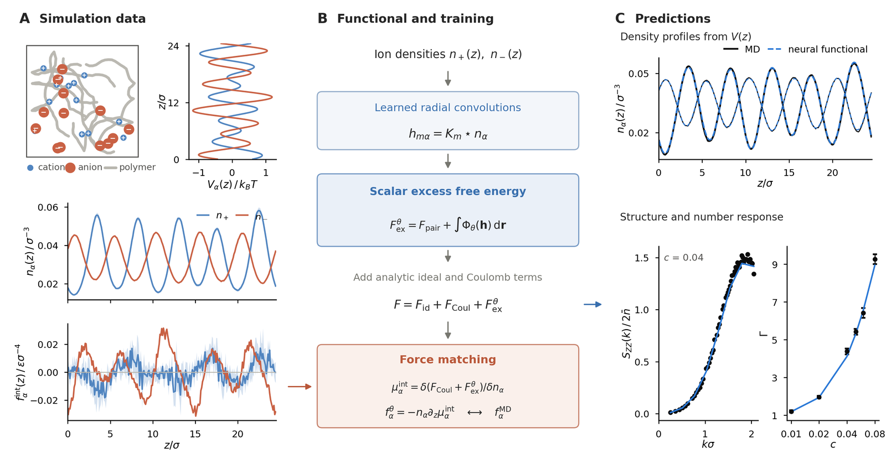
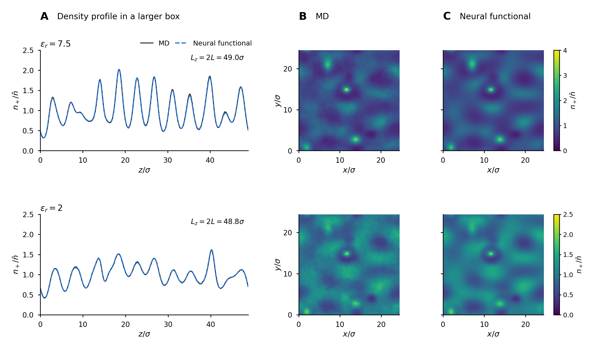

<div align="center">

# Neural density functionals for polymer electrolytes

**A structure-preserving neural density functional for the ions of a polymer electrolyte across Coulomb coupling strengths**<br>
Liyao Lyu

[Reproduce the results](docs/reproduction.md) · [Data and models](docs/data.md) · [Simulation model](code/md/README.md)




</div>

Learn the correlations beyond the analytic Coulomb mean field from molecular-dynamics force densities. Radial kernels and a scalar free-energy readout preserve integrability and continuous spatial symmetries. The permittivity enters only through the Bjerrum length, so one functional, trained at five dielectric constants, predicts ion profiles, bulk structure and finite-wavenumber number response across Coulomb coupling strengths, including at a dielectric constant left out of training.

## Results at a glance

Mean relative profile errors over the paper's test runs at each of the two reported dielectric constants (20 held-out runs plus the 22 runs at the untrained concentration `c = 0.05`, i.e. 42 runs per dielectric constant), for the single functional trained across the five dielectric constants 7.5, 5, 4, 3 and 2 (276 training runs, 75 validation runs and 86 held-out runs in total; per-permittivity counts in [docs/reproduction.md](docs/reproduction.md)):

| Dielectric constant | Neural functional | Learned pair closure |
| :--- | ---: | ---: |
| 7.5 | **1.14%** | 2.78% |
| 2 | **1.64%** | 5.36% |

The test domain spans `c = 0.01–0.08`. The pair closure is fitted at each dielectric constant separately. The manuscript and supplementary information define the broader architecture comparison, the leave-one-out tests across permittivities, convergence criteria and uncertainty estimates. [Exact values and selected fits](results/tables/paper-results.json).

## Start here

The result check uses Python's standard library and does not train a model:

```sh
python scripts/reproduce.py verify
```

To install the computational environment and redraw the generalization figure:

```sh
python3.12 -m venv .venv
.venv/bin/python -m pip install -r requirements.txt
.venv/bin/python scripts/reproduce.py figure --figure 3
```



## Repository guide

| Directory | Contents |
| :--- | :--- |
| [`code/learn`](code/learn) | JAX functionals, force matching, canonical solvers and bulk response |
| [`code/md`](code/md) | Coarse-grained LAMMPS inputs and profile-processing tools |
| [`code/figures`](code/figures) | Figure reconstruction and numerical-analysis helpers |
| [`data/md`](data/md) | Processed profiles, applied potentials, bulk summaries, Coulomb energies and data splits at five dielectric constants |
| [`data/models`](data/models) | Model configurations, checkpoints and per-run evaluations |
| [`data/predictions`](data/predictions) | Larger-box, nonplanar and permittivity-series evaluation summaries |
| [`results`](results) | Final manuscript figures, archived figure arrays and canonical numerical tables |
| [`docs`](docs) | Reproduction instructions and data conventions |

Raw MD trajectories and restart files are stored separately. The compact nonplanar arrays needed to redraw Figure 3 are included; recomputing all maps or trajectory uncertainties requires the raw data.

Use GitHub's **Cite this repository** button for the software citation. Add the manuscript's archival identifier when it becomes available.
